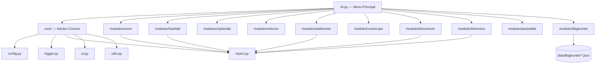

# 🔥 PABLOCYBERSEC V5 — ULTIMATE LINUX CTF FRAMEWORK

```
  ____   _    ____  _     ___     ______ _____ ____  _____ ______ ____
 |  _ \ / \  | __ )| |   / _ \   / / ___|_   _| __ )| ____|  _ \/ ___|
 | |_) / _ \ |  _ \| |  | | | | / / |     | | |  _ \|  _| | |_) \___ \
 |  __/ ___ \| |_) | |__| |_| |/ /| |___  | | | |_) | |___|  _ < ___) |
 |_| /_/   \_\____/|_____\___/_/  \____|  |_| |____/|_____|_| \_\____/
```

**ONE FRAMEWORK. MULTIPLE CAPABILITIES.**

Plataforma modular de cibersegurança para Linux, focada em **CTFs**,
laboratórios educacionais, **TryHackMe** e **Hack The Box**.

| | |
|---|---|
| **Categoria** | Linux Cybersecurity & CTF Framework |
| **Desenvolvimento** | PabloCyberSec |
| **Linguagens** | Python 3 (lógica) · Bash (instalação/integração) |
| **Licença** | MIT (ver [LICENSE](LICENSE)) |
| **Status** | Beta funcional — 10 módulos implementados e testados |

---

## Sumário

- [Objetivo do projeto](#objetivo-do-projeto)
- [Os 10 módulos](#os-10-módulos)
- [Arquitetura](#arquitetura)
- [Requisitos](#requisitos)
- [Instalação](#instalação)
- [Uso básico](#uso-básico)
- [Exemplos reais de utilização](#exemplos-reais-de-utilização)
- [Configuração de wordlists](#configuração-de-wordlists)
- [Configurações da plataforma](#configurações-da-plataforma)
- [Executando os testes](#executando-os-testes)
- [Solução de problemas frequentes](#solução-de-problemas-frequentes)
- [Limitações técnicas conhecidas](#limitações-técnicas-conhecidas)
- [Aviso de uso responsável](#aviso-de-uso-responsável)
- [Licença e contribuição](#licença-e-contribuição)
- [Histórico de versões](#histórico-de-versões)

---

## Objetivo do projeto

A PABLOCYBERSEC V5 concentra, em uma única interface de terminal,
ferramentas próprias de:

- Reconhecimento e enumeração de redes
- Criptografia e hashing para CTF
- Diagnóstico e comunicação de rede
- Análise de aplicações web
- Correlação de vulnerabilidades
- Auditoria local de Linux (privilege escalation)
- Análise forense digital
- Análise de tráfego de rede (PCAP)
- Organização e detecção de flags de CTF

O projeto **não tenta substituir** ferramentas consolidadas como Nmap,
Netcat, Burp Suite ou Wireshark — ele implementa versões próprias,
mais simples e focadas no fluxo de trabalho de CTF, reduzindo a
necessidade de alternar entre dezenas de ferramentas diferentes para
tarefas básicas e intermediárias.

---

## Os 10 módulos

| # | Módulo | O que faz | Rede ativa? |
|---|--------|-----------|:---:|
| 01 | **PC Recon** | Descoberta de hosts, varredura de portas TCP assíncrona, banner grabbing, resolução DNS (A/AAAA/PTR). | ✅ |
| 02 | **PC HashLab** | Identificação heurística de hash, cálculo (MD5/SHA-1/SHA-2/SHA-3/BLAKE2), comparação, verificação de integridade, teste contra wordlist. | ❌ |
| 03 | **PC CipherLab** | Base64/32, hex, URL encoding, binário, ROT13, César, Vigenère, XOR, análise de frequência, detecção de formato. | ❌ |
| 04 | **PC NetCore** | Cliente/servidor TCP, teste de conectividade, transferência de arquivos (sem execução remota de comandos). | ✅ |
| 05 | **PC WebHunter** | Cabeçalhos HTTP, cookies, redirecionamentos, TLS, detecção de tecnologia, enumeração de diretórios. | ✅ |
| 06 | **PC VulnScope** | Correlaciona serviço+versão com uma base local de CVEs conhecidos — gera **hipóteses**, nunca confirmações automáticas. | ❌ |
| 07 | **PC LinuxEnum** | Enumeração local **somente leitura**: sudo, SUID/SGID, cron, portas, processos — para privilege escalation. | ❌ |
| 08 | **PC Forensics** | Identificação de arquivo por assinatura, hashes, metadados, strings, hex dump, inspeção de ZIP. | ❌ |
| 09 | **PC PacketLab** | Análise de PCAP (via Scapy opcional) com fallback de leitura de cabeçalho sem dependências externas. | ⚠️ (leitura de arquivo) |
| 10 | **PC FlagHunter** | Detecta padrões de flag conhecidos, organiza hipóteses/evidências por caso, confirmação sempre manual. | ❌ |

> Módulos marcados como "Rede ativa" fazem conexões reais contra o
> alvo informado e **sempre pedem confirmação explícita de
> autorização** antes de agir.

### Detalhamento por módulo

<details>
<summary><strong>01 — PC Recon</strong></summary>

Motor de varredura próprio, inspirado nas funcionalidades essenciais
do Nmap (não é um substituto completo: sem SYN scan "stealth", sem
fingerprinting de SO, sem scripts NSE). Usa `asyncio` para
concorrência controlada por semáforo, com timeout configurável.

- Resolução de host (`socket.gethostbyname` + `getaddrinfo`/`gethostbyaddr`)
- Heurística de disponibilidade do host via sondas TCP (não usa ICMP
  cru, portanto não exige privilégios root)
- Varredura de portas por faixa (`1-1024`) ou lista (`22,80,443`)
- Banner grabbing simples, incluindo uma requisição `HEAD` mínima para
  portas HTTP comuns
</details>

<details>
<summary><strong>02 — PC HashLab</strong></summary>

Deixa explícito, em toda saída relevante, que **hashes não são
decodificados**: a única forma de "recuperar" uma senha é encontrar
uma entrada correspondente em uma wordlist (ou explorar uma fraqueza
específica do algoritmo, o que não está implementado para algoritmos
modernos).

- Algoritmos suportados: MD5, SHA-1, SHA-224/256/384/512, SHA3-224/256/384/512,
  BLAKE2b, BLAKE2s
- Identificação heurística por comprimento/alfabeto (incluindo
  reconhecimento de `$1$`, `$2a$/$2b$/$2y$`, `$6$`, `$y$`/`$7$` como
  prefixos de formatos de hash do `/etc/shadow` ou bcrypt)
- Comparação em tempo constante (`hmac.compare_digest`)
- Teste de senha contra wordlist com indicador de progresso e limite
  configurável de linhas processadas
</details>

<details>
<summary><strong>03 — PC CipherLab</strong></summary>

- Codificações reversíveis: Base64, Base32, hexadecimal, URL encoding, binário
- Cifras clássicas: ROT13, César (deslocamento único ou as 26
  possibilidades para análise manual), Vigenère
- XOR com chave conhecida ou força bruta de chave de 1 byte, com
  heurística de pontuação de plausibilidade de texto (favorece
  presença de `flag{`/`ctf{`, espaços e caracteres imprimíveis)
- Análise de frequência de letras com hipótese de deslocamento de
  César baseada na letra mais comum
- Detecção heurística de formato (Base64/32, hex, binário, URL encoding)
</details>

<details>
<summary><strong>04 — PC NetCore</strong></summary>

Inspirado nas funcionalidades úteis do Netcat, **sem** incluir
execução remota de comandos por padrão (nem como bind shell nem
reverse shell).

- Teste de conectividade TCP com medição de latência
- Listener TCP simples (aceita uma conexão, exibe dados recebidos)
- Cliente TCP simples (envia dados, lê resposta disponível)
- Transferência de arquivos com limite de tamanho configurável (200MB
  por padrão)
</details>

<details>
<summary><strong>05 — PC WebHunter</strong></summary>

Implementado com `urllib` da biblioteca padrão (sem dependência
obrigatória de `requests`).

- Inspeção de cabeçalhos, status, cookies (`Set-Cookie`) e cadeia
  completa de redirecionamentos (seguidos manualmente, com limite
  configurável)
- Inspeção de certificado TLS (subject, issuer, validade, versão do protocolo)
- Detecção de tecnologias por evidência observável em cabeçalhos/corpo
  (WordPress, PHP, Nginx, Apache, Express, Django, Laravel, Cloudflare,
  jQuery, React)
- Verificação de cabeçalhos de segurança recomendados ausentes (HSTS,
  CSP, X-Content-Type-Options, X-Frame-Options, Referrer-Policy)
- Enumeração de diretórios/caminhos com lista padrão embutida ou
  personalizada, com atraso configurável entre requisições
</details>

<details>
<summary><strong>06 — PC VulnScope</strong></summary>

Distingue três níveis em toda saída: **descoberta** (fato observado),
**hipótese** (vulnerabilidade possivelmente aplicável) e
**confirmação** (verificação ativa — não realizada automaticamente
por este módulo).

- Base de referência local pequena e ilustrativa, cobrindo CVEs
  amplamente conhecidos (ex.: Heartbleed, Shellshock, backdoor do
  vsftpd 2.3.4, Log4Shell, Struts CVE-2017-5638) — **não é um
  substituto** para NVD/MITRE
- Correlação por faixa de versão (evita falso positivo fora da faixa
  conhecida como afetada)
- Resumo por criticidade estimada (crítica/alta/média/baixa)
</details>

<details>
<summary><strong>07 — PC LinuxEnum</strong></summary>

**Modo padrão: somente leitura.** Nenhuma função deste módulo
modifica permissões, instala persistência ou altera configurações do
sistema — todas as operações são leitura de arquivos/metadados ou
execução de comandos de consulta já presentes no sistema (`ps`,
`sudo -l`, `ss`, `ip addr`).

- Usuário atual e grupos; listagem de todos os usuários (perfil completo)
- Permissões sudo (`sudo -n -l`), com alerta para regras `NOPASSWD`
- Busca de arquivos SUID/SGID/world-writable em diretórios de binários
  comuns, com indicação de binários frequentemente listados no
  GTFOBins
- Tarefas cron (usuário e sistema), portas em escuta, processos em
  execução, interfaces de rede (perfil completo)
- Verificação de caminhos sensíveis graváveis (`/etc/passwd`, `/etc/shadow`, etc.)
</details>

<details>
<summary><strong>08 — PC Forensics</strong></summary>

Preserva sempre o arquivo original — todas as operações são de
leitura.

- Identificação de tipo real por assinatura (magic bytes), incluindo
  alerta quando a extensão declarada não é compatível com o tipo
  detectado (técnica comum de disfarce em CTF)
- Cálculo de MD5/SHA256 e tamanho; listagem de conteúdo quando o
  arquivo é baseado em ZIP (inclui `.docx`, `.xlsx`, `.jar`, `.apk`)
- Extração de strings imprimíveis com comprimento mínimo configurável
- Busca por padrão regex nas strings extraídas
- Hex dump de uma seção arbitrária do arquivo (offset + tamanho)
</details>

<details>
<summary><strong>09 — PC PacketLab</strong></summary>

- Verifica a disponibilidade da biblioteca **Scapy** antes de
  qualquer operação que dependa dela — se ausente, informa claramente
  como instalar, em vez de falhar silenciosamente
- Com Scapy disponível: contagem de pacotes por protocolo, top
  talkers, consultas DNS únicas, hosts HTTP observados (via cabeçalho
  `Host:`), prévia de pacotes
- Sem Scapy: leitura do cabeçalho global de arquivos PCAP clássicos
  (formato, versão, snaplen, link type) sem nenhuma dependência externa
- Verificação (sem captura) de privilégios necessários para captura de
  tráfego ao vivo — a captura ao vivo em si **não está implementada**
  nesta versão; o módulo trabalha com arquivos PCAP já capturados
</details>

<details>
<summary><strong>10 — PC FlagHunter</strong></summary>

**Nunca inventa flags.** Toda flag "encontrada" corresponde, de forma
verificável, a um padrão de formato presente no texto de entrada
fornecido pelo usuário ou coletado de outro módulo.

- Detecção de padrões `flag{...}`, `ctf{...}`, `htb{...}`, `thm{...}`,
  `picoCTF{...}` e um padrão genérico `algo{...}`
- Pistas de codificação (hex/Base64/binário/URL encoding) sem
  decodificar automaticamente — direciona ao PC CipherLab
- Cadernos de caso persistentes em `data/flaghunter/<caso>.json`, com
  hipóteses, log de evidências e candidatos registrados
- Confirmação de flag sempre **manual**, exigindo descrição da
  evidência (ex.: "aceita pela plataforma X")
</details>

---

## Arquitetura



Cada módulo segue o mesmo padrão: `engine.py` contém a lógica pura
(testável sem interação de terminal) e `menu.py` expõe
`run_interactive(ui, settings, reporter)`, chamado pelo `cli.py`. Isso
mantém lógica de negócio e interface desacopladas — veja
[CONTRIBUTING.md](CONTRIBUTING.md) para detalhes.

### Estrutura do repositório

```
pablocybersec-v5/
├── README.md
├── LICENSE
├── CHANGELOG.md
├── CONTRIBUTING.md
├── requirements.txt
├── requirements-dev.txt
├── pyproject.toml
├── install.sh
├── uninstall.sh
├── cli.py                  # ponto de entrada
├── .gitignore
├── config/                 # settings.json gerado em tempo de execução
├── core/                   # núcleo comum
│   ├── config.py
│   ├── logger.py
│   ├── report.py
│   ├── ui.py
│   └── utils.py
├── modules/
│   ├── recon/        (01 — PC Recon)
│   ├── hashlab/       (02 — PC HashLab)
│   ├── cipherlab/      (03 — PC CipherLab)
│   ├── netcore/       (04 — PC NetCore)
│   ├── webhunter/      (05 — PC WebHunter)
│   ├── vulnscope/     (06 — PC VulnScope)
│   ├── linuxenum/      (07 — PC LinuxEnum)
│   ├── forensics/     (08 — PC Forensics)
│   ├── packetlab/      (09 — PC PacketLab)
│   └── flaghunter/    (10 — PC FlagHunter)
├── wordlists/          # suas próprias wordlists (não versionadas)
├── data/               # dados persistentes (ex.: cadernos do FlagHunter)
├── reports/            # relatórios gerados (JSON, não versionados)
├── logs/               # logs da aplicação (não versionados)
├── tests/              # suíte de testes pytest
└── docs/
```

---

## Requisitos

- **Sistema operacional:** Linux (testado oficialmente em Kali Linux,
  Debian e Ubuntu; deve funcionar em qualquer distro com Python 3.10+)
- **Python:** 3.10 ou superior
- **Dependências obrigatórias:** nenhuma além da biblioteca padrão do Python
- **Dependências opcionais:**
  - `scapy` — necessário apenas para análise completa de PCAP no PC PacketLab
- **Privilégios de root:** **não são necessários** para a maioria das
  funcionalidades. Alguns recursos específicos (captura de tráfego ao
  vivo, certas leituras do PC LinuxEnum) podem exigir privilégios
  adicionais — a ferramenta nunca pede root por padrão e sempre avisa
  quando uma função específica precisaria dele.

---

## Instalação

### Passo a passo genérico

```bash
# 1. Instalar dependências básicas (Debian/Ubuntu/Kali)
sudo apt update && sudo apt install -y python3 python3-venv python3-pip git

# 2. Clonar o repositório oficial
git clone https://github.com/pablocybersec/pablocybersec-v5.git

# 3. Entrar no diretório do projeto
cd pablocybersec-v5

# 4. Executar o instalador
chmod +x install.sh
./install.sh

# 5. (o instalador já cria/ativa o ambiente virtual automaticamente)

# 6. Verificar dependências e permissões (dentro da ferramenta, opção [11])

# 7. Iniciar a ferramenta
./pablocybersec

# 8. Executar os testes básicos de funcionamento
.venv/bin/pip install -r requirements-dev.txt
.venv/bin/pytest
```

### Instalação específica por distribuição

<details>
<summary><strong>Kali Linux</strong></summary>

Kali já vem com Python 3.10+ na maioria das versões recentes. Pode ser
necessário instalar `python3-venv` separadamente:

```bash
sudo apt update
sudo apt install -y python3-venv python3-pip
git clone https://github.com/pablocybersec/pablocybersec-v5.git
cd pablocybersec-v5
./install.sh
```

**Limitação conhecida:** em algumas imagens minimalistas do Kali (ex.:
containers Docker), os utilitários `ss`/`ip` podem não estar no PATH
por padrão, limitando partes do PC LinuxEnum. Instale `iproute2` se
necessário: `sudo apt install -y iproute2`.
</details>

<details>
<summary><strong>Debian</strong></summary>

```bash
sudo apt update
sudo apt install -y python3 python3-venv python3-pip git
git clone https://github.com/pablocybersec/pablocybersec-v5.git
cd pablocybersec-v5
./install.sh
```

**Limitação conhecida:** Debian Stable pode ter uma versão de Python
mais antiga que 3.10 em releases mais antigas. Verifique com
`python3 --version`; se necessário, use `pyenv` ou os repositórios
`backports` para obter uma versão compatível.
</details>

<details>
<summary><strong>Ubuntu</strong></summary>

```bash
sudo apt update
sudo apt install -y python3 python3-venv python3-pip git
git clone https://github.com/pablocybersec/pablocybersec-v5.git
cd pablocybersec-v5
./install.sh
```

Ubuntu 22.04+ já inclui Python 3.10+ por padrão. Em versões mais
antigas (20.04), instale uma versão mais recente via
`deadsnakes PPA` antes de rodar `install.sh`.
</details>

O `install.sh`:
- Detecta a distribuição e avisa sobre compatibilidade conhecida
- Verifica Python 3.10+ e o módulo `venv`
- Cria um ambiente virtual em `.venv/` (nunca instala pacotes globalmente)
- Instala dependências de `requirements.txt` (com aviso claro se algo
  opcional, como `scapy`, falhar)
- Cria os diretórios de apoio (`logs/`, `reports/`, `data/`, `config/`, `wordlists/`)
- Gera um script wrapper `./pablocybersec` e oferece criar um atalho
  em `~/.local/bin` **sem usar sudo**

Não executa comandos remotos sem inspeção, não desativa proteções do
Linux (firewall, SELinux, AppArmor) e não exige root para nenhuma
etapa, a menos que você mesmo decida rodar com `sudo` por escolha
própria.

---

## Uso básico

```bash
./pablocybersec
```

ou, diretamente com o Python do ambiente virtual:

```bash
.venv/bin/python cli.py
```

Isso abre o menu principal:

```
╔══════════════════════════════════════════════╗
║           PABLOCYBERSEC V5                  ║
║      ULTIMATE LINUX CTF FRAMEWORK           ║
║                                              ║
║   RECON • HASH • CIPHER • WEB • FORENSICS   ║
╚══════════════════════════════════════════════╝

[01] Reconhecimento de redes
[02] HashLab
[03] CipherLab
[04] NetCore
[05] WebHunter
[06] VulnScope
[07] LinuxEnum
[08] Forensics
[09] PacketLab
[10] FlagHunter

[11] Verificar dependências
[12] Configurações
[13] Histórico e relatórios
[14] Ajuda
[00] Sair
```

Digite o número da opção e pressione Enter. Dentro de qualquer módulo,
`0` ou Enter volta ao menu anterior, e `Ctrl+C` retorna com segurança
ao menu principal a qualquer momento.

---

## Exemplos reais de utilização

### Varrer portas comuns de um alvo autorizado (PC Recon)

```
Selecione uma opção > 01
Alvo (IP ou hostname) > 10.10.10.5
Confirma que você está autorizado a varrer '10.10.10.5'? [s/N] > s
Portas (ex: 1-1024, 22,80,443) [ENTER = top portas conhecidas] > 1-1000
Capturar banners? [S/n] > s

[*] Varrendo 1000 porta(s) em 10.10.10.5 (timeout=2.0s, concorrência=100)...

── Resultado — 10.10.10.5 ──────────────────────────
[*] IP resolvido: 10.10.10.5
[+] Status do host: provavelmente ativo
PORTA  SERVIÇO  LATÊNCIA(ms)  BANNER
22     ssh      12.4          SSH-2.0-OpenSSH_7.9
80     http     8.1           HTTP/1.1 200 OK...
```

### Identificar e quebrar um hash de CTF com wordlist (PC HashLab)

```
Selecione uma opção > 02
Escolha uma opção > 1
Cole o hash a identificar > 5f4dcc3b5aa765d61d8327deb882cf99
[*] Comprimento: 32 caracteres | Hexadecimal: True
[+] Candidatos prováveis: md5, ntlm (heurística: mesmo tamanho do md5)

Escolha uma opção > 6
Hash alvo > 5f4dcc3b5aa765d61d8327deb882cf99
Algoritmo [ENTER = sha256] > md5
Caminho da wordlist > rockyou_sample.txt
[+] Correspondência encontrada após 1 tentativa(s).
[+] Texto plano candidato: 'password'
```

### Decodificar uma cadeia Base64 de um desafio (PC CipherLab)

```
Selecione uma opção > 03
Escolha uma opção > 1
Codificar (c) ou decodificar (d)? [c/d] > d
Texto codificado > RkxBR3tleGVtcGxvX2N0Zn0=
[+] Resultado: FLAG{exemplo_ctf}
```

### Auditar privilege escalation em uma máquina CTF (PC LinuxEnum)

```
Selecione uma opção > 07
Perfil de enumeração: básico (b) ou completo (c)? [b/c] > c
[*] Coletando informações locais...

── Sudo ──
(sudo -l) (ALL) NOPASSWD: /usr/bin/vim
[!] Encontrada regra NOPASSWD — investigar possível escalonamento.

── Observações para investigação manual ──
[!] Binário SUID '/usr/bin/find' está na lista de binários
    frequentemente listados no GTFOBins — vale investigação manual.
```

### Organizar evidências de um desafio multi-etapas (PC FlagHunter)

```
Selecione uma opção > 10
Nome do caso/desafio [ENTER = 'default'] > web_challenge_03
Escolha uma opção > 1
Cole o texto a analisar > ...resposta HTTP contendo FLAG{pipeline_completo}...
Rótulo da fonte > WebHunter - enumeração de /api/debug
[+] 1 candidato(s) a flag encontrados:
  [flag_explicito] FLAG{pipeline_completo}  (fonte: WebHunter - enumeração de /api/debug)
```

---

## Comandos disponíveis e parâmetros

A PABLOCYBERSEC V5 é primariamente orientada a menu interativo — não
há (nesta versão) uma interface de linha de comando com flags por
módulo. A navegação é feita digitando o número da opção desejada.

| Comando no menu principal | Ação |
|---|---|
| `01`–`10` | Abre o módulo correspondente |
| `11` | Verifica dependências opcionais e ferramentas de sistema |
| `12` | Exibe e permite editar parâmetros numéricos de configuração |
| `13` | Lista o histórico de relatórios salvos e permite visualizar um |
| `14` | Exibe ajuda contextual e a lista de módulos |
| `00` ou Enter | Sai da aplicação |

Dentro de cada módulo, os submenus seguem o mesmo padrão: números para
escolher a ação, `0` ou Enter para voltar.

---

## Configuração de wordlists

Veja [`wordlists/README.md`](wordlists/README.md) para instruções
completas. Resumo:

1. Coloque seus arquivos de wordlist (uma palavra por linha) em `wordlists/`.
2. No PC HashLab, informe o caminho (relativo a `wordlists/` ou absoluto).
3. O limite padrão de processamento é de 2.000.000 de linhas,
   configurável no menu `[12] Configurações` (`hash_wordlist_max_lines`).

Nenhuma wordlist é distribuída com o projeto.

---

## Configurações da plataforma

As configurações ficam em `config/settings.json`, criado automaticamente
na primeira execução com valores padrão conservadores. Principais
parâmetros (acessíveis também pelo menu `[12]`):

| Parâmetro | Padrão | Descrição |
|---|---|---|
| `max_concurrent_connections` | 100 | Concorrência máxima no PC Recon |
| `default_timeout_seconds` | 2.0 | Timeout de rede padrão |
| `max_ports_per_scan` | 65535 | Limite de portas por varredura |
| `rate_limit_requests_per_second` | 20.0 | Taxa máxima de requisições no PC WebHunter |
| `http_request_timeout` | 5.0 | Timeout de requisições HTTP |
| `hash_wordlist_max_lines` | 2.000.000 | Limite de linhas processadas no PC HashLab |
| `log_level` | INFO | Nível de log gravado em `logs/pablocybersec.log` |
| `redact_sensitive_values` | true | Redige senhas/tokens/segredos nos logs |
| `color_output` | true | Habilita cores no terminal (`NO_COLOR=1` para desabilitar) |

---

## Executando os testes

```bash
.venv/bin/pip install -r requirements-dev.txt
.venv/bin/pytest -v
```

A suíte cobre a lógica de todos os 10 módulos (`engine.py` de cada
um) de forma isolada da interface de terminal, além do núcleo comum
(`core/`). Testes que exigem rede usam servidores locais efêmeros
(`127.0.0.1`), nunca alvos externos reais.

---

## Solução de problemas frequentes

**"ModuleNotFoundError: No module named 'core'" ao rodar `cli.py`**
Execute a partir da raiz do projeto (`cd pablocybersec-v5 && ./pablocybersec`),
não de dentro de `modules/` ou `core/`.

**PC PacketLab diz que Scapy não está disponível**
Isso é esperado se você não instalou a dependência opcional. Rode:
```bash
.venv/bin/pip install scapy
```
A opção `[2]` do módulo (leitura de cabeçalho sem dependências) continua
funcionando normalmente mesmo sem Scapy.

**PC LinuxEnum mostra "ss: não encontrado" ou "ip: não encontrado"**
Instale o pacote `iproute2` (ou `net-tools` para `netstat` como
alternativa) na sua distribuição. O módulo continua funcionando com
funcionalidade reduzida nessas seções específicas.

**Cores aparecem como códigos estranhos no terminal**
Defina a variável de ambiente `NO_COLOR=1` ou `PABLOCYBERSEC_NO_COLOR=1`
antes de executar, ou use um terminal com suporte a ANSI.

**Permissão negada ao executar `./install.sh` ou `./pablocybersec`**
Rode `chmod +x install.sh pablocybersec` para torná-los executáveis.

**A varredura do PC Recon não encontra um host que eu sei que está ativo**
A heurística de disponibilidade usa sondas TCP (não ICMP puro, para
não exigir root) contra um pequeno conjunto de portas. Hosts com
firewall muito restritivo podem não responder a nenhuma delas. A
varredura de portas em si ainda é executada mesmo que a sonda de
disponibilidade falhe.

---

## Limitações técnicas conhecidas

- **PC Recon:** connect scan apenas (sem SYN "stealth"), sem
  fingerprinting de sistema operacional, sem scripts estilo NSE.
- **PC VulnScope:** base de referência local pequena e ilustrativa;
  resultados são sempre hipóteses, nunca confirmações. Consulte NVD/MITRE.
- **PC PacketLab:** análise completa de pacotes requer Scapy
  (dependência opcional); sem ela, apenas o cabeçalho do arquivo é lido.
  Captura de tráfego ao vivo não está implementada nesta versão.
- **PC NetCore:** não implementa execução remota de comandos, por design.
- **PC LinuxEnum:** verificações dependem de utilitários do sistema
  (`ss`, `ip`, `sudo`, `crontab`) estarem disponíveis no PATH; quando
  ausentes, a seção correspondente fica vazia com aviso claro.
- **Interface:** não há (ainda) uma CLI com flags/argumentos por
  módulo — toda a navegação é via menu interativo.
- **Concorrência de rede:** o PC Recon usa `asyncio` em um único
  processo; varreduras muito grandes (ex.: todas as 65535 portas em
  muitos hosts simultaneamente) são mais lentas que ferramentas
  compiladas dedicadas.

---

## Aviso de uso responsável

A PABLOCYBERSEC V5 é destinada exclusivamente a:

- Educação e aprendizado em cibersegurança
- Defesa e auditoria de sistemas **que você tem autorização explícita
  para testar**
- Resolução de desafios de CTF em plataformas como TryHackMe, Hack The
  Box e competições similares
- Laboratórios próprios e ambientes controlados

**Usar esta ferramenta contra sistemas, redes ou aplicações de
terceiros sem autorização explícita pode ser ilegal** na sua
jurisdição. Os módulos que realizam conexões de rede ativas (PC Recon,
PC NetCore, PC WebHunter) sempre solicitam confirmação explícita de
autorização antes de agir, mas essa confirmação não substitui a
responsabilidade legal e ética do usuário. O autor e os contribuidores
deste projeto não se responsabilizam pelo uso indevido do software —
ver [LICENSE](LICENSE) para os termos completos.

---

## Licença e contribuição

Este projeto é distribuído sob a [Licença MIT](LICENSE).

Contribuições são bem-vindas! Veja [CONTRIBUTING.md](CONTRIBUTING.md)
para o guia completo de como propor mudanças, a estrutura esperada de
um módulo e os princípios de design do projeto (honestidade técnica,
escopo educacional/autorizado, segurança por padrão).

---

## Histórico de versões

Veja [CHANGELOG.md](CHANGELOG.md) para o histórico completo de
mudanças. Resumo da versão atual:

**v5.0.0** — Primeira versão pública. Núcleo comum completo e os 10
módulos (Recon, HashLab, CipherLab, NetCore, WebHunter, VulnScope,
LinuxEnum, Forensics, PacketLab, FlagHunter) implementados, testados
individualmente e integrados ao menu principal via `cli.py`.

---

<p align="center">
Desenvolvido por <strong>PabloCyberSec</strong><br>
<em>ONE FRAMEWORK. MULTIPLE CAPABILITIES.</em>
</p>
